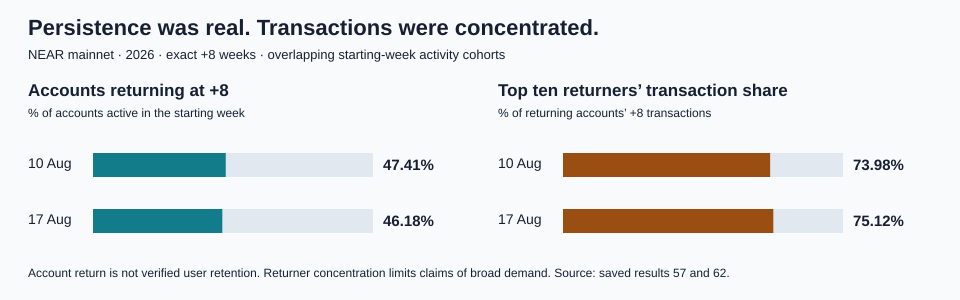
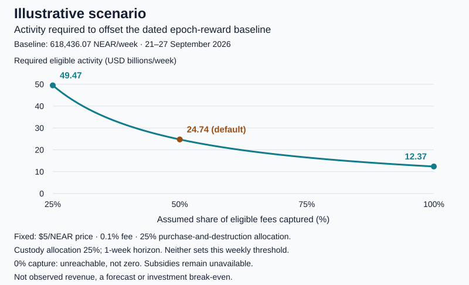

# NEAR Growth Intelligence

**A reproducible investment thesis connecting NEAR’s network growth, returning accounts, execution quality and token economics.**

**[Dashboard](https://near-growth-intelligence.streamlit.app)** ·
**[Investment thesis](THESIS.md)** ·
**[Conditional model](notes/conditional_investment_model.md)** ·
**[Demo post](https://x.com/insightX01/status/2117243839995855107)**

## Executive summary

**The question.** Does growing use of the NEAR network translate into durable
value for NEAR token holders?

**The conclusion.** NEAR demonstrates persistent network execution, but usage is
concentrated and its contribution to token-holder value remains unverified.
Observed supply growth, together with a protocol-derived upper bound of 1.62% of
issuance on net supply debit, weakens a simple “fees burn away inflation”
argument.

**Key findings** (NEAR mainnet, 2026; derived results reproduce offline from saved inputs; see [Verify it locally](#verify-it-locally) for source-level limits)

| Finding | Measurement | Scope and qualification |
| --- | --- | --- |
| Supply kept growing | **+4,935,983.98 NEAR** exact total-supply increase | 24 August–18 October, exact block headers at nine weekly anchors |
| Net supply debit has a low upper bound | Net supply debit **at most 1.62%** of 4.94–5.02 million NEAR epoch-reward issuance | Upper bound derived from protocol rules, not a direct measurement or gross burn; subsidies not separated |
| Many accounts return | **47.41% / 46.18%** exact +8-week returns | Accounts active in the 10 and 17 August starting weeks; accounts are not verified people |
| …but activity is concentrated | Top ten returners produce **73.98% / 75.12%** of returning accounts’ +8 transactions | Same two cohorts; the cohorts overlap |
| Treasury-named inflows are about one-fifth of issuance | **956,945.11 NEAR** external net native inflow to three wallets = **19.07–19.39%** of issuance | Same opening and closing blocks as the supply figures; inflows unclassified |

The three-wallet external inflows are **not verified revenue, purchases, buybacks
or issuance offsets**; they show scale only.

**What remains unproven.** Revenue origin and buyback execution, gross burn and
subsidies, holder cash flows, independent human adoption and any fair value. The
editable [conditional model](notes/conditional_investment_model.md) turns
explicit assumptions into the activity needed to offset issuance. It is not a
valuation, price target or recommendation.

## Check it in 60 seconds

Open the dashboard tabs, or inspect the linked saved evidence. Each row gives a
specific observation to check.

| Check | Where | What to observe |
| --- | --- | --- |
| Growth depends on the baseline | **Growth** → Four-week averages; [comparison](results/39_extended_activity_comparison_2026-07-06_to_2026-10-18.csv) | Four-week averages rise; fifteen-week endpoints fall. |
| Persistence has limits | **Account returns** → Persistence and scoped execution; [thesis table](notes/investment_thesis.md#persistence-and-initial-execution) | Exact +8 returns near 47% and 46%, concentrated transactions, overlapping groups and scoped initial success. |
| Supply components differ | **Economics** → One exact reward week; [reward evidence](results/72_supply_protocol_validated_week_2026-09-21_to_2026-09-27.json) | 23 validated reward applications; implied debit remains distinct from independently measured burn. |
| Net supply debit has a low upper bound | **Economics** → Eight-week issuance is bounded; [bounds](notes/eight_week_issuance_bounds.md) | Across 184 reward applications, net supply debit is at most 1.62% of issuance; the measured control week lies inside its bounds. |
| Treasury scale over the same blocks | **Economics** → Same blocks, three wallets; [comparison](results/108_supply_treasury_same_block_comparison_2026-08-24_to_2026-10-18.json) | External net native inflow equals 19.07–19.39% of issuance; inflows stay unclassified. |
| Wallet inflow is not revenue | **Economics** → Three-wallet native ledger; [ledger](notes/three_wallet_ledger_consolidation.md) | Native stocks/flows, internal-transfer cancellation and an unallocated difference. |
| Follow actual execution | **Growth drivers** → Inspect a selected mechanism; [cases and coverage](notes/priority4_attribution_plan.md) | Sweat delegation, wx transfer-and-callback, and failed tinykoala controls; selected examples have explicit population denominators. |
| Challenge the investment assumptions | **Decision priorities** → Conditional investment model; [formula review](notes/conditional_model_review.md) | Edit price, fee/capture and allocations. Revenue, destruction and custody remain separate; missing measurements stay unavailable. |

## Evidence

### 1. Persistence, execution and concentration

The 10 and 17 August 2026 activity cohorts have exact +8 returns of
**47.41% / 46.18%** of starting-week accounts. Their top ten returners produce
**73.98% / 75.12%** of returning accounts’ +8 transactions. Three initial-receipt
pilots for the 5–11 and 12–18 October submission weeks show **82.35–92.99%**
initial-receipt success among the selected returner populations, with six-day
execution tails. Cohorts overlap, and initial success is not complete-chain
success. [Validated cohort evidence](results/62_integrated_research_evidence.json).



*Nearly half returned at +8, while leading returners dominated transactions; the denominators differ and cohorts overlap. [Evidence](results/62_integrated_research_evidence.json).*

### 2. Supply and treasury economics

**One measured reward week.** During **21–27 September 2026**, 23 epoch
applications record **618,436.07 NEAR of protocol-validated reward minting**,
excluding separately unavailable subsidies. [Supply evidence](results/72_supply_protocol_validated_week_2026-09-21_to_2026-09-27.json).

**Eight weeks bounded by protocol rules.** Exact supply at nine weekly anchors
rose **4,935,983.98 NEAR** between 23 August and 18 October. Nearcore’s supply
identity and reward ceiling put epoch-reward issuance at **4.94–5.02 million
NEAR**. They put net supply debit (fee burning net of subsidies) at **0–80,060
NEAR, at most 1.62% of issuance**. Supply therefore grew at essentially the
2.47–2.51% annualised reward rate. The measured reward week lies inside its
derived range, at 99.51% of the ceiling. These are protocol-derived bounds, not
measured gross burn. They constrain a supply-based argument; other
value-capture mechanisms remain incompletely attributed, not ruled out.
[Bounds and method](notes/eight_week_issuance_bounds.md) · [Result 107](results/107_eight_week_issuance_bounds_2026-08-24_to_2026-10-18.json).

**Three treasury-named wallets over the same blocks.** Three wallets receive
**956,945.11 NEAR of external net native inflow**; two transfers between them
cancel. A **0.0010849311842748 NEAR** stock-flow difference remains
unallocated. Because their balances were recorded at the same two blocks as the
supply anchors, this inflow can be compared exactly: it equals **19.07–19.39% of
issuance**. This is a scale comparison only. The inflows are unclassified, held
balances remain in total supply, and three native-layer wallets are not the full
treasury system. [Native ledger](results/80_three_wallet_native_ledger_and_asset_assessment_2026-08-24_to_2026-10-18.json) · [Same-block comparison](results/108_supply_treasury_same_block_comparison_2026-08-24_to_2026-10-18.json).

### 3. Execution mechanisms and the conditional model

Two selected Sweat cases each have **eight successful receipt outcomes**; the
jar-deposit case nevertheless reports a **rejected booster application**. Other
controls retain **six successful wx receipt outcomes**, and **18 tinykoala
graphs containing failure**. They are not population success estimates;
[coverage percentages and denominators](notes/priority4_attribution_plan.md) are
disclosed. [Selected jars case](notes/sweat_jars_case_study.md) · [Selected wx graph](notes/wx_cruce_case_study.md).

The implemented model converts explicit assumptions into capture thresholds.
Its **illustrative default** reward-only threshold is **$24.74 billion/week** of
eligible activity at a 0.1% fee, 50% capture, 25% destruction allocation and
$5/NEAR effective price. Destroying the eight-week observed net supply growth
instead needs about $24.68 billion/week at the same assumptions. These are
scenario thresholds, not observed revenue or expected returns.
[Model derivation](notes/conditional_model_review.md#exact-illustrative-default-calculation).



*Higher assumed capture lowers the required eligible activity with other assumptions fixed. [Model](notes/model_sensitivity_chart.md) · [Exact scenario data](results/101_model_capture_sensitivity.json).*

## Investment conclusion

> **NEAR demonstrates persistent network execution, but usage is concentrated and
> its contribution to token-holder value remains unverified. Observed supply
> growth and a protocol-derived upper bound of 1.62% of issuance on net supply
> debit weaken a simple fee-burn-offset argument.**

**Supporting evidence:** repeat account activity, successful initial execution
and recorded NEAR spending demonstrate execution use. The dated reward week,
eight-week issuance bounds, native balance bridge and selected downstream graphs
make parts of the economic account auditable. They do not establish fresh
purchases or holder cash flows.

**Contrary evidence:** across **6 July–18 October 2026**, endpoint transactions
fell **10.63%** and active signing accounts **24.65%**, despite higher four-week
averages. Returner transactions are concentrated; **91.90%** of tinykoala’s
778,588 primary-window transactions had failed initial receipts. The
protocol-derived upper bound on net supply debit is 1.62% of issuance. Selected successes do not remove those
population findings. [Evidence and interpretation](notes/investment_thesis.md).

**What would change the conclusion:** three complete cohorts with ≥40% exact
+8 returns and ≤50% top-ten transaction concentration would strengthen the
persistence premise; three below 25% returns or above 80% concentration would
weaken it. Economic strengthening requires eight classified, reconciled weekly
asset ledgers and attributed capture meeting the chosen model hurdle, alongside
independent supply accounting. The eight-week protocol bounds narrow issuance
and net debit but do not provide independent gross-burn, subsidy or revenue
measurements; those remain incomplete. These are analyst-selected tests, not
outcomes already met. [Execution, supply and economic revision conditions](notes/investment_thesis.md#conditions-that-would-change-the-thesis).

## Verify it locally

Use Python 3.12 from the repository root. One-time setup:

```bash
python3.12 -m venv .venv
.venv/bin/python -m pip install -r requirements.txt
```

Run the unified offline verification:

```bash
.venv/bin/python -B analysis/44_rebuild_integrated_research.py --check
```

Expect exit code **0** and `source_requests: 0`. The command checks the original
published results and the reviewed model. It re-derives **12 evidence results**
from saved captures and inputs (`new_evidence_artifacts_reproduced: 12`), among
them the eight-week issuance bounds (result 107) and the same-block treasury
comparison (result 108). It also reproduces [result 100](results/100_integrated_research_review.json),
the figures and the [five-deliverable status table](notes/deliverable_status.md).
Network operations and subprocess launches are disabled; existing evidence is
never overwritten. All published derived evidence reproduces from saved inputs.
Some original source-level validations are limited. Header-prefix arithmetic
uses saved validated summaries, and full raw-header revalidation requires
retained external files that are not in the repository. Measurements that were
never available (gross burn, subsidies, attributed revenue) cannot be
reproduced.
[Rebuild details and checks](notes/integration_validation.md).

Results 107 and 108 can also be checked on their own:

```bash
.venv/bin/python -B analysis/50_eight_week_issuance_bounds.py report --check
.venv/bin/python -B analysis/51_supply_treasury_comparison.py report --check
```

Launch the saved-data dashboard with
`.venv/bin/python -m streamlit run dashboard/app.py`. No BigQuery credentials or
custom `PYTHONPATH` are required. The conditional model is editable in
**Decision priorities**; its assumptions are illustrative, not measured fee capture.

## Coverage and material limitations

NEAR mainnet, UTC: transaction context covers **6 July–18 October 2026**
(**79,171,891 transactions**, fifteen complete weeks); network economics cover
**24 August–18 October** (**44,284,794 transactions**, eight weeks). Selected
cohorts begin on 10 August; initial-receipt lookup tails end on 24 October.

- **Accounts:** identifiers, not verified people or new users. Exact-week
  returns differ from any-return unions; repeated return means all +1/+4/+8
  checkpoints, not continuous weekly activity. Incomplete follow-ups remain
  unavailable.
- **Supply:** full-window issuance and net debit are protocol-bounded, not
  measured, and protocol parameters are verified at anchor epochs, not at every
  epoch. Independent full-week debit, gross burn and subsidies remain
  unavailable; the 144-block header prefix is not extrapolated. The eight-week
  supply-versus-validator residual remains **+16,599.51 NEAR**; validator
  changes are not issuance. Spending is not actual burn.
- **Treasury and revenue:** native flows are one asset layer. Fee origin,
  complete token/internal balances and purchase execution remain unverified.
  Three wallets are not the complete treasury system. The bounded
  withdrawal-provenance investigation is closed; missing attribution does not
  prove nonoccurrence.
- **Precision and valuation:** original BigQuery cost/supply fields are
  FLOAT-derived. Exact RPC integers and saved decimal strings are preserved;
  rounding is for display. The model is implemented, while empirical
  calibration remains incomplete. No fair value, price target or expected
  investment return is established.

Full-window supply, the multi-asset revenue/buyback ledger and broad attribution
remain partial; validated cohort outputs do not complete wider execution
coverage. [Original criteria and current status](notes/deliverable_status.md) ·
[Detailed methodology and checks](notes/data_checks.md).

## Repository map

| Path | Contents |
| --- | --- |
| [THESIS.md](THESIS.md) | Entry point to the maintained investment argument and revision conditions. |
| [dashboard/](dashboard/) | Interactive views and reviewed conditional model. |
| [sql/](sql/) · [analysis/](analysis/) | Source-query definitions, offline validators and rebuild tooling. |
| [results/](results/) | Saved exports, derived evidence and bounded captures. |
| [notes/](notes/) · [docs/](docs/) | Methods, accounting investigations, research status and visual assets. |
